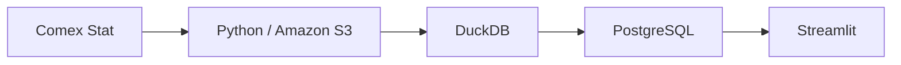

# Vem Ser Natter 2026 | Desafio Técnico — Dados & IA

> Processo seletivo de estágio · Dados & Inteligência Artificial

## 1. Sua missão

Transformar dados públicos do comércio exterior brasileiro em uma solução analítica, construindo uma jornada de dados de ponta a ponta: da descoberta da fonte à visualização.

Você deverá desenvolver um pipeline que capture dados de exportação e importação por município do Comex Stat a partir de 2010, armazene os arquivos brutos em um Data Lake S3, trate os dados e disponibilize uma base relacional local para análise de **soja, milho e algodão**.

## 2. Tecnologias

- Python
- Amazon S3
- DuckDB (a utilização da API Python do DuckDB é opcional)
- PostgreSQL
- SQLAlchemy
- Streamlit
- Git e GitHub

## 3. Fluxo da solução



## 4. Escopo técnico

### Etapa 01 — Descoberta e captura dos dados

Acesse a [Base de dados bruta do Comex Stat](https://www.gov.br/mdic/pt-br/assuntos/comercio-exterior/estatisticas/base-de-dados-bruta).

Identifique os mecanismos de download, URLs, APIs (quando disponíveis) e formatos dos arquivos. Desenvolva código Python para capturar:

- Dados de exportações por município, a partir de 2010 até o ano mais recente disponível;
- Dados de importações por município, para o mesmo período;
- Dados mestres de produtos, países e municípios, disponíveis na seção de tabelas de correlação.

Para o ETL de NCM deste desafio, utilize o arquivo **SH - Sistema Harmonizado** como fonte dos dados mestres de produtos. Identifique os campos, formatos e chaves necessários para relacionar as bases.

A descoberta dos mecanismos de captura faz parte da avaliação de autonomia e capacidade exploratória.

### Etapa 02 — Ingestão no Data Lake

Implemente scripts Python para enviar os arquivos brutos de comércio exterior e os dados mestres ao bucket S3 `natter-estagio`, exclusivamente dentro do prefixo `<seu-primeiro-nome>_comex/`.

Preserve os arquivos originais e organize os conjuntos de dados. A estrutura interna abaixo é sugerida; o prefixo individual é obrigatório.

```text
natter-estagio/
└── <seu-primeiro-nome>_comex/
    ├── exportacoes/
    ├── importacoes/
    └── dados_mestres/
```

### Etapa 03 — Tratamento e banco relacional

Crie um script Python que leia os dados do S3 e utilize DuckDB para tratar e filtrar as operações referentes a soja, milho e algodão. A utilização da API Python do DuckDB é opcional.

Instancie e configure um PostgreSQL local. Utilize a biblioteca **SQLAlchemy** em Python para criação das tabelas, consultas e inserção dos dados.

#### O que é SH4?

O SH4 é a posição de quatro dígitos do Sistema Harmonizado, correspondente aos quatro primeiros dígitos do NCM (Nomenclatura Comum do Mercosul), que possui oito dígitos.

A base municipal do Comex Stat apresenta operações agregadas por SH4, não por NCM completo. Investigue a relação entre as classificações, documente os códigos selecionados e evite multiplicar valores ao relacionar as tabelas. Não atribua um NCM específico a uma operação sem evidência na fonte.

Utilize o arquivo **SH - Sistema Harmonizado** como fonte da tabela `dim_ncm`, na granularidade SH4.

#### Tabelas obrigatórias no PostgreSQL

| Tabela | Tipo | Conteúdo esperado |
| --- | --- | --- |
| `fato_exportacoes` | Fato | Operações de exportação filtradas |
| `fato_importacoes` | Fato | Operações de importação filtradas |
| `dim_ncm` | Dimensão | Cadastro de produtos na granularidade SH4 |
| `dim_municipios` | Dimensão | Cadastro de municípios |
| `dim_paises` | Dimensão | Cadastro de países |

As tabelas fato devem contemplar período, produto na granularidade disponível, município, país, peso líquido e valor FOB. Defina os tipos de dados e relacionamentos, garanta a consistência dos valores e documente o comportamento em reexecuções.

### Etapa 04 — Visualização com Streamlit

Desenvolva uma aplicação Streamlit que consulte os dados tratados no PostgreSQL e permita explorar as operações de comércio exterior.

Sugestões de análise (não obrigatórias):

- Evolução anual das operações;
- Valor FOB em US$ e peso líquido;
- Principais países e municípios;
- Filtros por produto e período;
- Comparação entre exportações e importações.

A organização visual e a escolha dos indicadores ficam a seu critério.

### Etapa 05 — Versionamento e documentação

Utilize o repositório oficial [Natter-Dados/vem-ser-natter-2026](https://github.com/Natter-Dados/vem-ser-natter-2026).

- Crie uma branch com seu nome;
- Realize commits descritivos durante o desenvolvimento;
- Abra um Pull Request para revisão, sem fazer merge por conta própria;
- Entregue a documentação da sua solução em Markdown (`README.md`);
- Não inclua credenciais no GitHub.

A documentação da sua solução deverá explicar a instalação, dependências, configuração do PostgreSQL e AWS, ordem de execução dos scripts, execução do Streamlit e decisões de modelagem.

## 5. Acesso ao ambiente AWS

| Configuração | Valor |
| --- | --- |
| Bucket | `natter-estagio` |
| Prefixo | `<seu-primeiro-nome>_comex/` |
| Região | Confirmar com a equipe |
| Access Key ID e Secret Access Key | Consultar o material de acesso fornecido pela equipe |

Utilize variáveis de ambiente para configurar as credenciais. Nunca publique chaves no repositório.

## 6. Checklist de entrega

- [ ] Código Python de captura e upload dos dados brutos de exportação e importação a partir de 2010.
- [ ] Código Python de captura e upload dos dados mestres de produtos (SH), países e municípios.
- [ ] Arquivos brutos armazenados no prefixo individual do bucket `natter-estagio`.
- [ ] Script Python de tratamento com DuckDB e filtragem de soja, milho e algodão.
- [ ] PostgreSQL local com as cinco tabelas obrigatórias e utilização de SQLAlchemy.
- [ ] Aplicação Streamlit funcional.
- [ ] Branch individual e Pull Request no GitHub.
- [ ] README.md da solução com instruções completas.

## 7. O que queremos conhecer

| Competência | O que será observado |
| --- | --- |
| Autonomia | Capacidade de explorar fontes, pesquisar e resolver problemas. |
| Qualidade técnica | Organização do código, consistência dos dados e modelagem relacional. |
| Visão analítica | Clareza das visualizações e interpretação das informações. |
| Colaboração | Versionamento, Pull Request e documentação reproduzível. |

## 8. Aviso de confidencialidade

> **Este documento é de uso exclusivo dos candidatos autorizados no processo seletivo Vem Ser Natter 2026.**
>
> Não compartilhe, encaminhe ou publique este documento fora do ambiente autorizado do processo seletivo. Não divulgue as chaves de acesso da AWS a terceiros, nem as inclua em códigos, commits, Pull Requests, prints ou documentação. Utilize as credenciais exclusivamente para a execução do desafio.

---

**Vem Ser Natter 2026 — Dados & IA**

Boa sorte no desafio!
